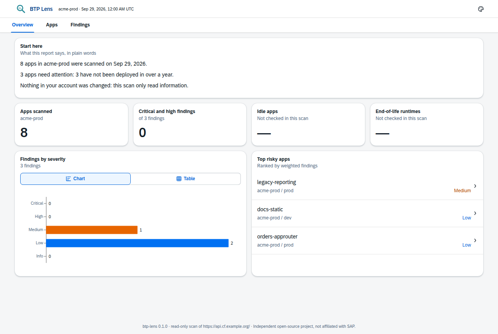
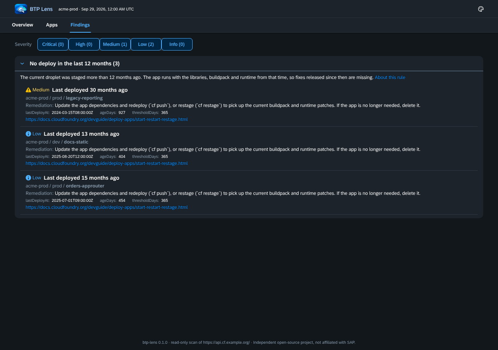
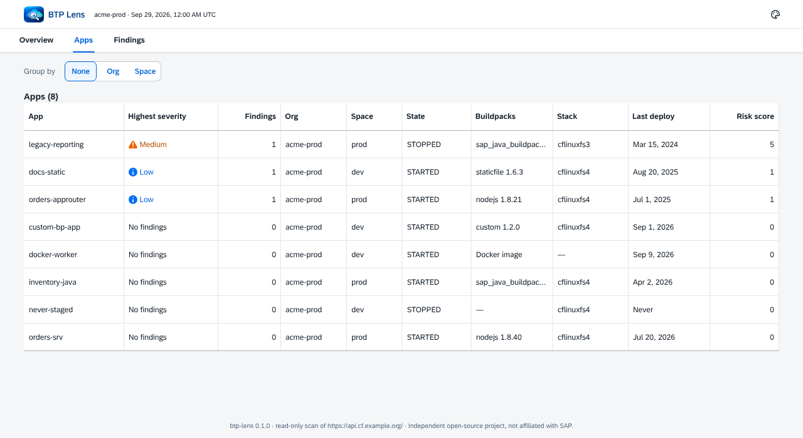

<p align="center">
  <picture>
    <source media="(prefers-color-scheme: dark)" srcset="docs/assets/logo-dark.png">
    
  </picture>
</p>

# BTP Lens

**A read-only health and security scanner for Cloud Foundry landscapes on SAP BTP.** Open source under Apache-2.0, free for everyone, built in public, and it runs on your machine.

Point BTP Lens at a Cloud Foundry org. With nothing more than the **Space Auditor** role, it inventories every app, flags stale deployments, and writes an **offline HTML report** plus JSON, CSV and SARIF. Checks for end-of-life runtimes, outdated buildpacks and libraries, known vulnerabilities and risky configuration follow in the next releases.

It sends only `GET` requests to the Cloud Foundry API. It contacts no third party except for public version and vulnerability lookups, and it never writes user names, tokens or secret values into its output.

[](https://github.com/sebastianomarchesini/BTP-Lens/actions/workflows/ci.yml)
[](https://github.com/sebastianomarchesini/BTP-Lens/actions/workflows/security.yml)
[](LICENSE)
<!-- Add once the Scorecard workflow has run on main:
[](https://scorecard.dev/viewer/?uri=github.com/sebastianomarchesini/BTP-Lens)
-->

> **Status: 0.1.0, first public release.** It includes guided mode, the app inventory, the `APP_NO_RECENT_DEPLOY` rule, all report formats and the HTML report. The other rules are planned in [docs/rules.md](docs/rules.md) and the [roadmap](docs/roadmap.md). Feedback from real landscapes is very welcome in the issues.
>
> This first release is aimed at **developers and platform teams**. Guided mode and the no-terminal guide were written for non-developers but have not yet been tested with them in usability sessions; those sessions are planned for 0.1.1. If you are not a developer and try it anyway, every hesitation you report is a contribution.



## Try it in five minutes (guided mode)

You need [Node.js](https://nodejs.org) (the LTS installer, next-next-finish) and a BTP login with the **Space Auditor** role, which is read-only. You do not need the cf CLI.

```sh
npx btp-lens
```

Guided mode asks four questions: where your landscape is (pick a region or paste the API endpoint from the cockpit), how to sign in (your browser opens your company login and shows a one-time code), which org, and whether to start. The report then opens in your browser. Never used a terminal? Follow the [step-by-step guide with screenshots](docs/getting-started-no-terminal.md). Something not working? `npx btp-lens doctor` checks Node.js, network, certificates, login and the output folder and tells you what to do in one sentence each.

## Quickstart for developers and CI

```sh
cf login -a https://api.cf.eu10.hana.ondemand.com      # any user with Space Auditor
npx btp-lens scan --api https://api.cf.eu10.hana.ondemand.com --org my-org
open reports/btp-lens-report.html                      # works offline
```

### Project scan (no login needed)

```sh
npx btp-lens project --path ./my-cap-project      # reads the project files, contacts nothing
```

This checks a local CAP or MTA project the way a reviewer would: effective `cds` configuration per profile, `mta.yaml`, `xs-security.json`, `xs-app.json`, the CDS model, seed CSV files and the SAPUI5 bootstrap, and writes the same reports with a `file:line` location per finding (also in SARIF, for code scanning). The rules follow the OWASP Top 10 (2025) patterns of the public SAP TechEd 2026 workshop XP261; see [docs/rules.md](docs/rules.md#project-rules).

To run the latest development version from source (Node.js 22.12 or later):

```sh
git clone https://github.com/sebastianomarchesini/BTP-Lens.git && cd BTP-Lens
npm ci && npm run build
node packages/cli/dist/cli.js                          # guided mode
node packages/cli/dist/cli.js scan --api https://api.cf.eu10.hana.ondemand.com --org my-org
```

### Credentials

BTP Lens uses the first of these that is set:

1. `BTP_LENS_ACCESS_TOKEN`, for example `BTP_LENS_ACCESS_TOKEN="$(cf oauth-token)"`.
2. `BTP_LENS_CLIENT_ID` and `BTP_LENS_CLIENT_SECRET`, for an OAuth client with a CF role.
3. Your cf CLI session (`~/.cf/config.json`, or `$CF_HOME/.cf/config.json`). It must target the same API as `--api`. An expired token is refreshed in memory only, and the file is never written.

Behind a corporate proxy, set `HTTPS_PROXY` and `NODE_USE_ENV_PROXY=1` so that Node.js routes requests through it. That variable exists from Node.js 22.21 and 24.0; older versions ignore it, and `btp-lens doctor` says so.

## Commands

```text
btp-lens                       guided mode (four questions, report opens in the browser)
btp-lens guided [--no-open]    the same, explicitly
btp-lens doctor [--api <url>]  checks Node.js, network, certificates, login and output folder
btp-lens scan   --api <cf api url> --org <name> [--space <name>] [--deep]
                [--out ./reports] [--format html,json,csv,sarif] [--fail-on <severity>] [--concurrency 5]
btp-lens project --path <dir> [--out ./reports] [--format html,json,csv,sarif] [--fail-on <severity>] [--quiet]
btp-lens report --from <snapshot.json> [--format html,json,csv,sarif] [--out ./reports] [--fail-on <severity>]
btp-lens version
```

- With no arguments on a terminal, guided mode starts; in a script it prints usage and exits 2.
- `project` scans a local CAP or MTA project folder for the thirteen configuration and model rules in [docs/rules.md](docs/rules.md#project-rules) (mocked authentication in production, unrestricted services, missing audit logging, open approuter routes, seed data with card numbers, and more), each tagged with its OWASP Top 10 (2025) category. It reads files only: no login, no network, no child process, and it never opens `.env`, `.cdsrc-private.json`, `default-env.json`, keys or `*.mtaext` files.
- Guided mode signs in the way `cf login --sso` does (one-time code from your company login) or with username and password, keeps the session in memory only, and writes to `./btp-lens-reports/<date-time>/`.
- `scan` and `project` write one snapshot (`snapshot-<time>.json`) and the requested reports.
- `report --from` re-runs every rule on a snapshot **offline**, for example after you upgrade BTP Lens.
- Exit codes:
  - `0`: no findings at or above `--fail-on` (the default, `none`, never fails).
  - `1`: findings met the threshold.
  - `2`: tool error.

The HTML report is a single file. Fonts, themes and data are embedded, it follows your light or dark system setting, and it works at phone width. It carries a Content Security Policy with `connect-src 'none'`, so the browser itself refuses to let it connect anywhere, and only the scripts bundled at build time may run. The CSV output is UTF-8 with a byte-order mark, so Excel shows non-ASCII names correctly, and it neutralizes spreadsheet formulas (a name starting with `=`, `+`, `-` or `@` gets a leading apostrophe). The SARIF output (2.1.0) is ready for code-scanning tools. Report folders and files are created readable by you only.

## Permissions

| Check | Minimum CF role | Default |
| --- | --- | --- |
| App inventory and current droplets (`collect.apps`, `collect.droplets`), rule `APP_NO_RECENT_DEPLOY` | Space Auditor | on |
| Planned: processes, buildpacks, stacks, routes, binding metadata and the rules built on them | Space Auditor | on, in the next releases |
| Planned: plain-text secrets in environment variable **names** (`ENV_SECRET_PLAINTEXT`) | Space Developer or Space Supporter | `--deep` only |
| Project scan (`collect.project` and the thirteen project rules) | none: local files, no login, no network | on, for `btp-lens project` |

The Cloud Foundry list endpoints answer with what your user may see rather than with 403, so a user who can see the org but none of its spaces gets a clear message and exit code 2 instead of an empty report. When a call does return 403, the check is recorded as *skipped: insufficient role* and the scan continues. Details are in [docs/permissions.md](docs/permissions.md).

## Privacy

- **Read-only:** the HTTP client refuses any method other than `GET` to the CF API. The only `POST` request goes to the OAuth token endpoint.
- **No data leaves your machine:** 0.1.0 talks to your CF API and its login server (UAA) and to nothing else. The egress allow-list also names `api.osv.dev`, `endoflife.date`, `ui5.sap.com` and `registry.npmjs.org` for the version and vulnerability rules of the next releases; none of them is contacted yet. There is no telemetry.
- **No personal data:** user names, emails and IDs are never written. Audit-event actors are dropped when the events are read.
- **No secrets:** tokens, environment variable values and service credentials are never printed or stored. Credentials in buildpack URLs are stripped, everything printed to the terminal passes through a redaction filter, and the endpoints that return credentials (`/v3/apps/:guid/env`, binding `details`) are refused by the allow-list even for `GET`.

See [docs/privacy.md](docs/privacy.md), [docs/faq.md](docs/faq.md), [docs/data-sources.md](docs/data-sources.md) and the [security review](docs/security-review.md).

Evaluating BTP Lens for your company? [docs/due-diligence.md](docs/due-diligence.md) answers the questions that managers and security, legal and procurement teams ask before a first run, each with the code, test or document behind it.

## Sample report

| Findings (dark theme) | Apps |
| --- | --- |
|  |  |

These screenshots use the synthetic `acme-prod` fixture landscape. Run `npm run sample` to generate the same report in `reports/sample/`.

## Development

```sh
npm ci
npm run build        # UI single-file template, then the CLI
npm test             # unit and fixture tests (no live calls)
npm run lint && npm run typecheck && npm run format:check
npm run sample       # sample reports from the fixture snapshot
npm run e2e          # opens the HTML report with networking disabled (Playwright)
```

The repository is an npm workspaces monorepo:
- `packages/cli` holds the `btp-lens` CLI.
- `packages/ui` holds the React and UI5 Web Components report.
- `docs/` holds the verified data sources, rules, permissions and privacy notes.

## Contributing and community

BTP Lens is built in public. The [roadmap](docs/roadmap.md) and [governance](docs/governance.md) are in the repository, rules can be proposed by anyone with the "Rule proposal" issue template, and [CONTRIBUTING.md](CONTRIBUTING.md) has a 15-minute first contribution and the recipe for adding a rule. Non-developers are welcome: testing guided mode, answering questions in the issues and improving the docs count as much as code. Please read the [Code of Conduct](CODE_OF_CONDUCT.md). Contributions need a signed [Contributor License Agreement](docs/CLA.md). To report a vulnerability, see [SECURITY.md](SECURITY.md).

## Support the project

BTP Lens is free and will stay free. If it saved you an afternoon of clicking, consider [sponsoring](https://github.com/sponsors/sebastianomarchesini). The first goal is a code-signing certificate, so that administrators can run a downloadable executable without warnings. Sponsors are listed in [SPONSORS.md](SPONSORS.md); sponsorship never influences what the tool reports.

## Not affiliated with SAP

BTP Lens is an independent open-source project. It is **not affiliated with, endorsed by or sponsored by SAP SE** or its affiliates. "SAP", "SAP BTP", "SAPUI5" and "Fiori" are trademarks of SAP SE, used here only to describe compatibility. The report uses the open-source UI5 Web Components (Apache-2.0) for its look and feel, and carries no SAP logo.

## License

[Apache-2.0](LICENSE). Third-party notices are in [NOTICE](NOTICE), and every HTML report embeds the licenses of the software it bundles.
